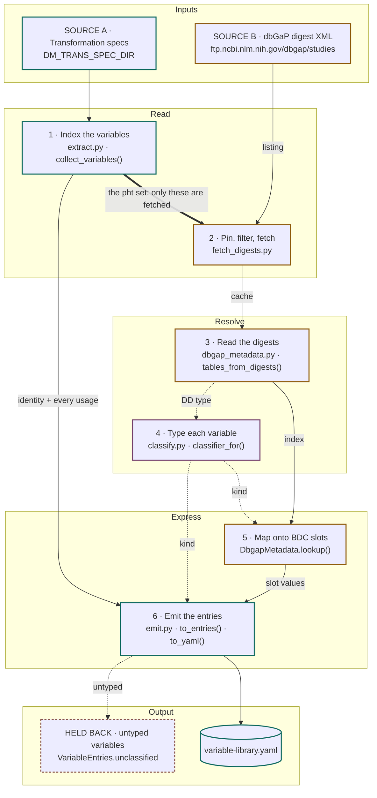

# Variable Library Extractor

Design notes for `src/dm_bip/variable_lib/`: a deterministic command that reads
transformation specs, fetches the dbGaP data dictionaries those specs reference, and emits
BDC variable library entries (`SingleContinuousVariable` and `SingleCategoricalVariable`
instances). Deliverable 4.5 Task 2,
[tis-lab/BDC-Add-On-Tracker#93](https://github.com/tis-lab/BDC-Add-On-Tracker/issues/93).
Modeled on the mapping-provenance tool, whose spec-reading layer it reuses.

## Contents

- [Why the study/dataset/variable join matters](#why-the-studydatasetvariable-join-matters)
- [The chain](#the-chain)
- [What the typing signal looks like](#what-the-typing-signal-looks-like)
- [Design decisions](#design-decisions)
    - [Layers: parse, decide, express](#layers-parse-decide-express)
    - [Reuse the spec-reading layer, don't re-parse](#reuse-the-spec-reading-layer-dont-re-parse)
    - [`datasets` is a set](#datasets-is-a-set)
    - [Classification reads the data dictionary's type, and nothing else](#classification-reads-the-data-dictionarys-type-and-nothing-else)
    - [Unclassified variables are held back, not defaulted](#unclassified-variables-are-held-back-not-defaulted)
    - [Determinism](#determinism)
- [What fills each slot](#what-fills-each-slot)
- [Fetching dbGaP metadata](#fetching-dbgap-metadata)
- [Running it](#running-it)
    - [Running it against a real cohort](#running-it-against-a-real-cohort)
- [Running the tests](#running-the-tests)
- [Known limitations](#known-limitations)

## Why the study/dataset/variable join matters

dbGaP identifies phenotype data at three nested levels, each with its own accession prefix:
a **study** (`phs`) holds **datasets** (`pht`), which hold **variables** (`phv`).

```
phs000101              study      the study as registered in dbGaP
└── pht000113          dataset    one table within it
    └── phv10111300    variable   one column in that table
```

A `phv` is unique across all of dbGaP and belongs to exactly one dataset in exactly one
study, so it identifies a measurement on its own. The dataset and study are not readable off
the accession, though: recovering them means a lookup against dbGaP. Carrying all three on
every entry keeps that join explicit without the lookup, which is what
[linkml/dm-bip#352](https://github.com/linkml/dm-bip/issues/352) requires: **the join must
survive harmonization.** The BDC variable library's own representation flattens contributing
sources into parallel comma-delimited lists, which breaks it. Equivalent variables recur
across studies under different accessions, so nothing in the accession itself links them;
that is the harmonization layer's job.

A transformation spec states the join directly: the dataset is a class-level
`populated_from`, the variables are the slot-level ones beneath it, and the study is the
directory they sit in. That is why each entry carries the full phv/pht/phs triple, and it is
what makes the dbGaP half possible: a `(pht, phv)` pair indexes straight into a data
dictionary.

---

## The chain

Two provenance streams converge on one file. The transformation specs say *which* source
variables exist and what they feed; the dbGaP digests say what those variables *mean*, and
which of the two classes each takes.



The two crossing edges are the ones worth reading. Stage 1's set of `pht` accessions
becomes the filter on stage 2's download, so a cohort's full published listing is never
fetched. And the classifier built in stage 4 is consulted twice: once to pick the entry
class, once to decide which slot set stage 5 is even allowed to return.

All of it happens in one process. Stage 2 is the only one that writes to disk, yielding the
digest cache, which later runs reuse.

---

## What the typing signal looks like

**The join to the data dictionary is exact, not fuzzy.** The canonical DD that
schema-automator's adapter renders from a dbGaP digest pair is one table per `pht`, and
each row's `uri` carries the `phv`:

```
name     type                 description               codes                unit   min  max  uri
BMI01    decimal              Body mass index, exam 1.                       kg/m2  13.1 61.2 dbgap:phv00204719.v1
SEX      permissible_values   Reported sex.             2, Female | 1, Male                   dbgap:phv00000002.v1
```

So `(pht, phv)` from a trans spec indexes directly into the dictionary, keyed on the bare
accession. Specs are unversioned (`phv00202843`); the DD carries dbGaP's versioned form
(`phv00202843.v2`), and the join strips the version.

**The `type` column is the decision.** The adapter resolves it from dbGaP's declared
`<type>` and the var_report's `calculated_type` into a closed vocabulary: `integer` and
`decimal` are quantities; `permissible_values`, `boolean`, `string` and the temporal and
identifier types are labels. `schema-create` reads the same DD, so the two consumers agree
by construction. Nothing here applies a distinct-value threshold or any other heuristic to
decide what counts as categorical; that would be a second rule, made here, about a question
the adapter has already answered.

---

## Design decisions

### Layers: parse, decide, express

```
src/dm_bip/variable_lib/
├── extract.py          # spec → VariableRecord (the IR)
├── classify.py         # DD type → continuous | categorical
├── dbgap_metadata.py   # digests → canonical DD index → BDC slot values
├── emit.py             # VariableRecord + kind + metadata → schema instances
└── datamodel/          # gen-pydantic output
```

plus `prepare_study/fetch_digests.py`, which fetches and caches the digests. Same split as
`mapping_prov`: extraction depends only on the specs and stays testable on its own, and
`dbgap_metadata.py` is the only layer that knows BDC slot names.

### Reuse the spec-reading layer, don't re-parse

`extract.py` imports `iter_spec_blocks`, `spec_url`, `read_study` and `default_base_dir`
from `dm_bip.mapping_prov.extract`; nothing in `variable_lib` parses YAML itself. That
layer is owned by `mapping_prov`, and improving it improves both consumers. If a third
consumer appears, those should be lifted into a shared module rather than imported
sideways.

### `datasets` is a set

Nothing in the spec format prevents the same accession appearing under two `pht` values.
`file_id` is single-valued, so `sole_dataset()` collapses it, warning and picking the lowest
accession rather than silently taking whichever spec was read first.

The choice is load-bearing: the chosen `pht` decides which data dictionary is consulted, and
with it the variable's type and every descriptive slot. ARIC has four such variables today,
all `SUBJECT_ID` columns that `spirometry.yaml` references from fragments populated from
another table. For three of them the lowest accession happens to be the table that declares
the variable. `phv00516587` is the exception ([NHLBI-BDC-DMC-HV#880][hv-880]): it collapses
to a table whose dictionary does not declare it and is held back. Preferring the `pht` under
which a dictionary actually knows the variable would be the better rule.

### Classification reads the data dictionary's type, and nothing else

The canonical DD already carries a `type` for every variable, resolved by schema-automator's
adapter from dbGaP's declared and calculated types, and `schema-create` reads the same DD.
So the continuous-or-categorical decision is made once, upstream, and `classify.py` only
maps that vocabulary onto the two classes. A variable the dictionary does not describe is
`unknown`, counted, and held back, rather than typed from a second source that might
disagree with the first. `classifier_for(tables)` returns `always_unknown` and says so when
there are no dictionaries at all.

One limit is inherited from upstream. The adapter currently types any variable that carries
codes as `permissible_values`, so a numeric variable with sentinel codes (an age with `-9`
for missing) comes out categorical. [linkml/schema-automator#231][sa-231] asks the adapter
to check `calculated_type` first, and that fix reaches the library with no change here.

### Unclassified variables are held back, not defaulted

`source_id` and `file_id` are defined only on the two typed classes, so there is no
correctly-typed home for an unclassified variable's identity, and defaulting to either
class would assert something unproven about the data. They are collected in
`VariableEntries.unclassified`, counted, and reported.

### Determinism

- Records sorted by accession; usages sorted within each record and deduplicated.
- Digest files loaded in sorted order.
- Coded values kept in **document order**: dbGaP orders them meaningfully (Yes/No, severity
  scales), and the order of an input file is already stable.
- No `uuid4()` and no timestamps anywhere; ids derive from the accession.

Running twice and diffing gives byte-identical output, and a cold-fetch run and a cached run
produce the same file.

---

## What fills each slot

**From the specs**, available without any second input:

| Slot | Value | From |
|---|---|---|
| `id` | `dbgap:phv10111300` | accession, matching the mapping-prov convention |
| `source_id` | `phv10111300` | `VariableRecord.accession` |
| `file_id` | `pht000113` | `VariableRecord.sole_dataset()` |
| `associated_study` | `bdchm:Study/phs000280` | `read_study()` on the directory's `researchstudy.yaml`; a placeholder named after the directory when there is none |
| `variable_description` | rendered from `usages` | `describe()` |

**From the canonical DD**, everything else:

| Slot | DD column | Notes |
|---|---|---|
| `variable_name` | `name` | dbGaP's VARNAME |
| `source_variable_description` | `description` | dbGaP's VARDESC |
| `file_name` | the DD's filename | dbGaP's table name, which the pipeline puts in the filename |
| `data_type` | `type` | mapped onto the BDC enum |
| `minimum_value`, `maximum_value` | `min`, `max` | **Continuous only.** The var_report's observed bounds |
| `coded_values` | `codes` | **Categorical only**, in document order |
| `unit` | `unit` | **Continuous only.** Empty until the adapter carries `<unit>` ([#231][sa-231]) |
| `comment` | `comment` | Empty until the adapter carries `<comment>` ([#231][sa-231]) |
| `missing_value` | `missing_values` | **Continuous only.** Sentinel codes; empty until the adapter writes the column ([#231][sa-231]) |
| `resolution`, `alert_values` | none | Always empty; dbGaP states neither, and deriving them would be inference |

`associated_study` is **never** supplied by the metadata source. `emit` merges `lookup`'s
return over the identity fields, so returning it would let a table contributed by another
study overwrite the study the spec belongs to.

A real entry, the first five slots from the spec and the rest from the dictionary:

```yaml
single_continuous_variables:
- id: dbgap:phv00203151
  associated_study: bdchm:Study/phs000280
  variable_description: Source for Quantity.value_decimal
  source_id: phv00203151
  file_id: pht004032
  file_name: ANTA
  variable_name: ANTA01
  source_variable_description: '[Height and weight]. Standing height (to the nearest
    cm). Q1 [Anthropometry Form, ANTA. Visit 1]'
  data_type: integer
  minimum_value: '125'
  maximum_value: '199'
```

Keys with no matching slot on the chosen class are dropped with a warning rather than
silently discarded.

---

## Fetching dbGaP metadata

A cohort's `pheno_variable_summaries/` directory holds every dataset the study ever
published, far more than one set of specs references. The `pht` accession is in each
filename:

```
phs000280.v8.pht004027.v3.ABI04.data_dict.xml
                └──────┘
```

so the listing is filtered to the datasets the specs name before anything is downloaded, at
no extra request cost; for ARIC that is well under half the listing (the counts are under
[running it against a real cohort](#running-it-against-a-real-cohort)). There
is a half-second courtesy delay between NCBI requests, and cached runs re-read from disk. A
dataset the specs name but the listing lacks is reported by accession.

Both digest files are fetched per dataset. `data_dict.xml` is what the study declares;
`var_report.xml` adds the `calculated_type` and the observed `min`/`max` that the adapter needs
to resolve a type and bounds, which is why `--no-var-report` is not the default: it halves the
download and loses both. How the adapter reconciles the two is schema-automator's concern; see
[linkml/schema-automator#231][sa-231] for its current gaps.

---

## Running it

The library needs the specs and a cohort, and nothing else: no prepared data, no inferred
schema, no validation output or mapped data.

```sh
# One directory of specs (one study), typed and described from that cohort's dictionaries
dm-bip extract-variable-library path/to/specs/<study> \
  --cohort aric \
  -o variable-library.yaml

# As part of the pipeline, with every path resolved from the pipeline config
make variable-library   CONFIG=path/to/study.mk DM_COHORT=aric
```

`--cohort` may be omitted: the command reads the study accession from the specs'
`researchstudy.yaml` and matches it against the upstream cohort manifests, reporting which
cohort it picked. Pass it explicitly when the spec directory has no `researchstudy.yaml`,
which release repos often don't carry. Omitting it on a study with no dbGaP presence is not
an error: the command says so, reports every variable as untyped, and emits nothing, since
there is no dictionary to type from.

Directories are searched recursively for `*.yaml` spec files, as in
[mapping provenance](mapping-provenance.md).

| Option | Default | Effect |
|---|---|---|
| `--cohort` | auto-detect | dbGaP cohort key (`aric`, `jhs`, …); `dm-bip fetch-digests --list` shows them |
| `--dbgap-cache` | `.dbgap-cache` | Where fetched XML lives. Gitignored |
| `--no-fetch` | fetches | Use only what is already cached, a genuine offline path |
| `--no-var-report` | uses both | Skip `var_report.xml`. Halves the download and **loses observed bounds** |
| `--refresh` | reuses cache | Re-download files already cached |
| `--dd-dir` | none | Read canonical DD TSVs (`*.dd.tsv`) from this directory, typically what `adapt-digests` wrote, instead of fetching and adapting digests. The fetch options above are then not consulted |

Without `--dd-dir`, the fetched digests are adapted in memory with the same schema-automator
adapter that `adapt-digests` runs, so both paths read the same canonical DD; only the
serialization to a file is skipped. That matters for one case: the adapter's TSV serializer
rejects a value dbGaP publishes with no `code` attribute ([#231][sa-231]), so `adapt-digests`
halts on such a table and a `make -k` directory lacks it, while the in-memory path enriches it
normally.

Where each argument comes from, for any study:

| Argument | Pipeline variable |
|---|---|
| spec dir | `DM_TRANS_SPEC_DIR` |
| `-o` | `VARIABLE_LIBRARY_FILE`, i.e. `$(DM_OUTPUT_DIR)/variable-library.yaml` |
| `--cohort` | `DM_COHORT` |
| `--dbgap-cache` | `DM_DBGAP_CACHE_DIR` |

`variable-library` is **not** wired into `make pipeline` and is **not** produced as a side
effect of `make map-data`; it has to be asked for by name. Being a file target, it prints
"Nothing to be done" when the output is newer than the specs. Delete just that file to force
a rebuild. The dbGaP cache is deliberately *not* a prerequisite: it is network-populated and
managed by the command, so listing it would leave the target perpetually out of date. The
direct `dm-bip extract-variable-library` form always regenerates.

### Running it against a real cohort

The real run needs two checkouts and a cohort key, and every command runs from this one:

| Checkout | Branch | Role |
|---|---|---|
| `dm-bip` | `variable-mapping-rb` until #376 merges | the command below |
| `NHLBI-BDC-DMC-HV` | `main` | the specs, `priority_variables_transform/<COHORT>-ingest` |

```sh
cd /path/to/dm-bip
uv run dm-bip extract-variable-library \
  /path/to/NHLBI-BDC-DMC-HV/priority_variables_transform/ARIC-ingest \
  --cohort aric \
  --dbgap-cache .dbgap-cache \
  -o variable-library.yaml
```

For ARIC in October 2026 the specs name 163 datasets, so the fetch is 326 of the 736 files
in the cohort's listing and a cold run takes about four minutes. Every later run reads the
cache and is offline. Swap `ARIC-ingest` and `aric` for `JHS-ingest` and `jhs` for the
second cohort with a published listing.

The same run through the pipeline target uses a config that sets `DM_TRANS_SPEC_DIR`,
`DM_COHORT`, `DM_DBGAP_CACHE_DIR` and `DM_OUTPUT_DIR`. The `cohorts/config.mk` in
[study-palette](https://github.com/tis-lab/study-palette) (branch `aric-corpus` until
[tis-lab/study-palette#38](https://github.com/tis-lab/study-palette/pull/38) merges) is one
such config, self-locating and deriving everything from `COHORT`; its synthetic tables are
for `schema-create` and the rest of the pipeline and are not read here:

```sh
make variable-library CONFIG=/path/to/study-palette/cohorts/config.mk COHORT=aric
```

That is a file target. To rerun it after a code change with the specs unchanged, delete the
output first, `$(DM_OUTPUT_DIR)/variable-library.yaml`, or use the direct form above, which
always regenerates.

## Running the tests

```bash
uv run pytest tests/unit/variable_lib tests/unit/test_fetch_digests.py -q
```

These are offline. The classifier and metadata fixtures are DD TSVs under
`tests/input/variable_lib/dd/`. The digest fixtures under `tests/input/variable_lib/dbgap/`
are one hand-written data_dict/var_report pair in two versions, one declaring the variable
the ARIC fixture specs name and one declaring none of them, which the CLI tests serve through
a mocked fetch to exercise dataset-coverage reporting. The full `make test` also runs
`tests/integration/test_mapping_prov_schema.py`, which needs network.

The pydantic `UserWarning` about `FieldInfo(annotation=NoneType...)` is pre-existing noise
from the generated datamodel, not a failure.

That datamodel is generated from `schema/variable_lib_schema.yaml`, a shim that exists only
because `gen-pydantic` takes a local file: it imports the upstream `bdc-variable-library`
schema by URL and tracks `main`. To regenerate it after an upstream change (needs network):

```bash
make variable-lib-datamodel
```

## Known limitations

- **`unit`, `comment` and `missing_value` are empty.** The adapter does not yet carry
  dbGaP's `<unit>` or `<comment>`, and has no column for the sentinel codes of a numeric
  variable ([#231][sa-231], items 2, 4 and 5). When it does, the library normalizes units to
  UCUM and passes unmapped ones through in the study's own spelling; the other two map
  straight across.
- **Decimal slots serialize as quoted strings**, `minimum_value: '125'`. That is `Decimal`
  round-tripping through `model_dump(mode="json")`, and it is stable. Not a bug.

[sa-231]: https://github.com/linkml/schema-automator/issues/231
[hv-880]: https://github.com/RTIInternational/NHLBI-BDC-DMC-HV/issues/880
